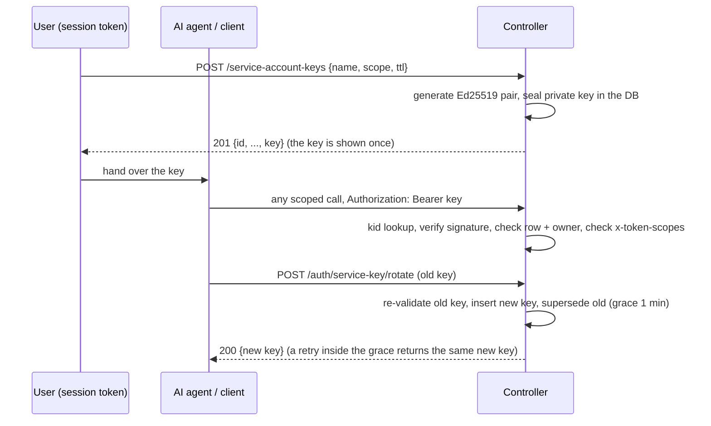
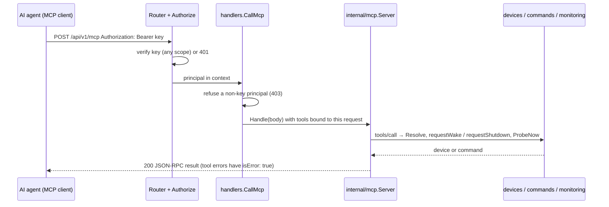

# HomeCore — Architecture Design

|                |                                                                                                                                                                                                                                                                                                                                                                                                                 |
|----------------|-----------------------------------------------------------------------------------------------------------------------------------------------------------------------------------------------------------------------------------------------------------------------------------------------------------------------------------------------------------------------------------------------------------------|
| Status         | **v0.2**, derived from [`BRIEF.md`](../../BRIEF.md) v0.1                                                                                                                                                                                                                                                                                                                                                        |
| Last reviewed  | 2026-11-18 (port forwarding, ADR-022); 2026-11-16 (Android mobile Controller integration); 2026-11-15 (alerts, ADR-021; earlier: MCP server, ADR-020; earlier: portable Agent, ADR-019; earlier: 2026-11-14 service account keys; legacy endpoints and scoped tokens; local interface names; Phase 4: DDNS and system metrics; earlier: Phase 3 shutdown dispatch, Controller key, agent status, activity feed) |
| Requirements   | [requirements/overview.md](../requirements/overview.md)                                                                                                                                                                                                                                                                                                                                                         |
| Related design | [database.md](database.md) · [agent-protocol.md](agent-protocol.md) · [decisions.md](decisions.md) (ADRs)                                                                                                                                                                                                                                                                                                       |
| API contract   | [api/openapi.yaml](../../api/openapi.yaml) (source of truth)                                                                                                                                                                                                                                                                                                                                                    |
| Roadmap        | [plans/roadmap.md](../plans/roadmap.md)                                                                                                                                                                                                                                                                                                                                                                         |

---

## 1. Purpose and scope

HomeCore is a lightweight, always-on home infrastructure service for a household or small group
(< 10 users). One Go code base produces:

- a **standalone binary** (`homecore`) for Linux, macOS (dev) and later Windows, and
- a **native library** (gomobile AAR) embedded in Android phone / Android TV Box apps.

The binary runs in one of three **modes**: `controller`, `agent` or `both`.

| Role       | Responsibilities                                                                                                                                                   |
|------------|--------------------------------------------------------------------------------------------------------------------------------------------------------------------|
| Controller | Device registry, TCP online monitoring, Wake-on-LAN, signed shutdown dispatch, Cloudflare DDNS, JWT-protected REST API, Swagger UI, static web UI, system metrics. |
| Agent      | Small HTTP listener on a managed machine that verifies signed commands from trusted Controllers and executes a fixed allowlist of power actions.                   |

### 1.1 MVP (in scope)

Controller + Agent on macOS/Linux · Device CRUD · TCP monitoring · Wake-on-LAN · secure shutdown
Agent on Linux · SQLite · JWT auth · Cloudflare DDNS · Swagger UI at `/api/docs` · static file serving.

### 1.2 Explicitly out of scope (do not build)

Clustering, distributed scheduling, WebSocket/SSE realtime, plugin systems, multiple DB engines,
message brokers, Redis, arbitrary command execution on agents, multi-tenant features.

---

## 2. Analysis of the brief

The brief is sound. The main shape (Go modular monolith, SQLite, HTTP/JSON, signed agent commands,
platform adapters) is kept. The review below lists **gaps and risks** found while turning it into a
buildable design, and how this document resolves them.

| #  | Finding                                                                                                                                          | Resolution                                                                                                                                                                                                                                                                |
|----|--------------------------------------------------------------------------------------------------------------------------------------------------|---------------------------------------------------------------------------------------------------------------------------------------------------------------------------------------------------------------------------------------------------------------------------|
| 1  | `shutdown_secret` as a device field implies a shared secret stored on both sides.                                                                | Ed25519: Controller signs, Agent stores only Controller **public** keys. The device stores `agent_id` + agent endpoint, no secret. (ADR-001)                                                                                                                              |
| 2  | Device `status` mixes *observed* state (online/offline) with *intended* transitions (`waking`).                                                  | Two fields: `status` = observed (`unknown/online/offline`); `power_transition` = derived from the active command (`none/waking/shutting_down`).                                                                                                                           |
| 3  | IP is not a stable identity under DHCP.                                                                                                          | Identity = UUID. `ip_address` / `hostname` are mutable *addresses*; `agent_id` identifies a running agent. (ADR-002)                                                                                                                                                      |
| 4  | `command accepted` ≠ `machine off/on`.                                                                                                           | Explicit command state machine with monitor-based verification and deadlines. (ADR-003, §8.2)                                                                                                                                                                             |
| 5  | SQLite on Android via gomobile is the largest technical risk.                                                                                    | Pure-Go `modernc.org/sqlite`, one driver everywhere. Cross-compile verified for `android/arm64`, `linux/{arm,arm64,amd64}`, `windows/amd64`, `darwin/arm64` with `CGO_ENABLED=0`. **On-device spike still required**, especially 32-bit `armeabi-v7a` TV boxes. (ADR-004) |
| 6  | Two Controllers on one LAN may both act on an Agent.                                                                                             | Agent trusts a list of Controller keys; idempotency by `command_id`; per-action cooldown. Monitoring by several controllers is harmless (read-only). (ADR-005)                                                                                                            |
| 7  | **Clock skew**: signed commands carry a timestamp (±30 s). Cheap Android TV boxes often have no RTC and boot with a wrong clock until NTP syncs. | Agent returns a distinguishable `clock_skew` error code; Controller surfaces it in the command result. Controller exposes its time in `/healthz`.                                                                                                                         |
| 8  | **Replay after agent restart**: an in-memory nonce cache is lost on restart, so a captured request could be replayed within the skew window.     | Agent additionally rejects any command whose `issued_at` is older than the agent process start time. No persistent nonce store required.                                                                                                                                  |
| 9  | JWT over plain HTTP on a LAN can be sniffed.                                                                                                     | Optional TLS on the Controller listener; recommend reverse proxy / VPN for remote access. Short access-token TTL (15 min) + rotating refresh tokens.                                                                                                                      |
| 10 | WOL from Android: `255.255.255.255` may leave via the wrong interface.                                                                           | Default to the **directed subnet broadcast** computed from the device IP + local interface mask; per-device `wol_broadcast_address` override; optional port 9 / 7.                                                                                                        |
| 11 | Android may kill background work (Doze, app standby). Phones are poor 24/7 hosts.                                                                | Kotlin host runs a foreground service; Go side must tolerate being stopped/restarted at any time (all state persisted, idempotent startup). TV Box is the primary Android target.                                                                                         |
| 12 | Agent needs root-level power to shut down, but the HTTP server must not run as root.                                                             | Linux: dedicated `homecore` user + polkit rule allowing only `org.freedesktop.login1.power-off`/`reboot`. Agent calls `systemctl poweroff`.                                                                                                                               |
| 13 | Shutdown request may be cut off when the machine powers down.                                                                                    | Agent replies `202 Accepted` first, executes after a configurable delay (default 3 s).                                                                                                                                                                                    |
| 14 | Public IP lookup from a single provider can lie or fail.                                                                                         | Query ≥ 2 providers; require agreement (quorum); keep last known IP on disagreement and record an error.                                                                                                                                                                  |
| 15 | Spec drift between OpenAPI and handlers.                                                                                                         | **Spec-first**: `api/openapi.yaml` → `oapi-codegen` (chi server + models + embedded spec). Generated code is committed.                                                                                                                                                   |
| 16 | Storing every probe result would grow the DB unboundedly.                                                                                        | `device_status_history` stores **transitions only**; retention job prunes history/commands older than N days.                                                                                                                                                             |

---

## 3. System context

```
                    LAN / VPN                                     Internet
 ┌────────────┐   HTTPS/HTTP + JWT   ┌──────────────────────────┐   HTTPS (scoped token)  ┌────────────────┐
 │ Browser /  │ ───────────────────▶ │       Controller          │ ──────────────────────▶ │ Cloudflare API │
 │ Mobile UI  │                      │  REST API · Swagger · UI  │ ──────────────────────▶ │ Public-IP svcs │
 └────────────┘                      │  Monitor · WOL · DDNS     │                         └────────────────┘
                                     │  Commands · SQLite        │
                                     └───┬──────────┬────────┬───┘
                     TCP connect probe   │          │ UDP    │ HTTP POST, Ed25519-signed
                  (ssh/rdp/agent port)   │          │ magic  │ /agent/v1/commands
                                         ▼          ▼ packet ▼
                                ┌──────────────────────────────────┐
                                │ Managed machine (Linux/Windows)  │
                                │  └─ HomeCore Agent (non-root)    │
                                │       └─ polkit → systemctl poweroff
                                └──────────────────────────────────┘
```

---

## 4. Runtime model

### 4.1 One binary, several modes

```
homecore --mode controller   # Controller only (default on Android)
homecore --mode agent        # Agent only
homecore --mode both         # Both, in one process, on two separate listeners
```

The Agent needs no file: `--agent-id`, `--trusted-controller` and `--agent-listen` carry its identity,
the Controller public key and its port (ADR-019). The web UI builds that command per operating system.
Started in a terminal with `--mode agent` and no identity, the binary asks for the pasted command
instead (`internal/agentsetup`) and writes a systemd unit (Linux) or a shortcut (Windows) for it.

In `both` mode the two roles share only the logger and process lifecycle. They have **separate
listeners, separate auth and separate config sections**. The Agent never reads the Controller DB
and the Controller REST API cannot reach Agent internals except over the signed protocol.

### 4.2 Process lifecycle

```
main / mobile.Start
  └─ config.Load (file → env overrides → validate)
  └─ app.New(cfg)               build components for the selected mode
  └─ app.Run(ctx)               errgroup: every component's Run(ctx) in parallel
        Controller: storage.Open+Migrate → schedulers (monitor, ddns, retention) → HTTP server
        Agent:      identity load/create → HTTP listener
  └─ SIGINT/SIGTERM or mobile.Stop → ctx cancel → graceful shutdown (bounded by shutdown_timeout)
```

Rules: every long-running component implements `Run(ctx context.Context) error` and returns when
`ctx` is cancelled. No goroutine is started outside a component's `Run`. Startup is idempotent so
Android can stop and restart the library freely.

---

## 5. Code layout and dependency rules

```
cmd/homecore/            CLI entrypoint (flags → config → app.Run)
mobile/                  gomobile bindings (only gomobile-compatible types)
api/openapi.yaml         REST contract (source of truth)
internal/
  app/                   composition root: wiring + lifecycle per mode
  config/                config structs, defaults, file/env loading, validation
  logging/               slog setup
  api/                   HTTP server, router, middleware, handlers, docs serving
    gen/                 oapi-codegen output (do not edit)
    middleware/
    handlers/
  auth/                  users, argon2id passwords, HS256 JWT, rotating refresh tokens, `homecore user` backend (no roles, ADR-011)
  audit/                 audit_log writer (auth, devices, shutdown, controller key)
  activity/              read-only activity feed over audit_log (`GET /activity`)
  controllerkey/         Controller Ed25519 key: generate, seal, load (`LoadOrCreate`), sign
  agentctl/              Controller-side client of the Agent: shutdown Dispatcher, health job
  alerts/                alert channels, adapters (Telegram), delivery queue, the hooks that connect ddns / commands / monitoring (ADR-021)
  devices/               device model, validation, repository
  monitoring/            TCP probe, hysteresis, scheduler job, status history
  wol/                   magic packet build/send, MAC parsing, broadcast resolution
  commands/              command model + state machine, dispatcher, history
  agent/                 Agent listener, verifier, executor
  agentsetup/            setup prompt: parses the UI command, writes the systemd unit / Windows shortcut
    protocol/            signed-command wire format (shared by Controller client and Agent)
  ddns/                  public IP discovery, Cloudflare client, sync job
  system/                metrics collection (via platform provider)
  secrets/               master key, AES-GCM sealing of secrets at rest
  storage/               SQLite open/pragmas, migrations (embedded), tx helpers
    migrations/          versioned *.sql files
  scheduler/             tiny interval runner with jitter
  platform/              OS adapters: power control, metrics, terminal no-echo input (`tty`) (build-tagged)
web/                     embedded UI (static/ = build of the frontend submodule, placeholder/ = fallback) + offline Swagger UI assets
frontend/                git submodule (HomeCoreUI source; built by `make ui-build`, see ADR-009)
configs/                 example configuration
deploy/                  systemd units, polkit rules
docs/                    requirements, design, plans, changelogs (see docs/README.md)
scripts/                 dev scripts (fetch Swagger UI, etc.)
```

Deviation from the brief's tree: `platform/` and `migrations/` moved under `internal/` because Go
`//go:embed` cannot reach parent directories and OS adapters should not be importable externally.

**Dependency rules** (enforced by review; keep the graph acyclic):

- `api/handlers` → domain packages (`devices`, `commands`, `auth`, `ddns`, `system`). Never the reverse.
- Domain packages depend on `storage` only through small repository interfaces defined **in the
  domain package** (consumer-side interfaces). SQL lives next to the domain (`devices/repo_sqlite.go`).
- `agent/protocol` depends on nothing but the stdlib — it is shared by both roles.
- `platform` is a leaf. Domain code receives platform capabilities as interfaces.
- Only `app` knows about all packages (composition root). No global singletons, no `init()` side effects.

Not every module needs model/service/repository layers — add a layer only when it has a second
implementation or a test that needs it.

---

## 6. Module design

### 6.1 HTTP API server (`internal/api`)
- `chi` router; generated `ServerInterface` from the spec; handlers embed `gen.Unimplemented`, so
  unimplemented operations return `501` while staying documented.
- Middleware order: request-id → client-ip (X-Forwarded-For only from `trusted_proxies` CIDRs) → recoverer → structured access log → body limit (1 MiB)
  → timeout (30 s) → CORS (allowlist, off by default) → rate limit (per-IP, stricter on `/auth/*`)
  → JWT auth (per-operation, driven by the spec's `security` requirements).
- `GET /api/openapi.json` serves the embedded spec; `GET /api/docs` serves Swagger UI from embedded
  assets (no CDN). `/healthz` = process alive; `/readyz` = DB reachable and migrations applied.
- Errors use one JSON shape: `{"error": {"code": "...", "message": "..."}}`.
- Optional TLS (`controller.tls.cert_file/key_file`).

### 6.2 Device registry (`internal/devices`)
Fields (see `devices` table): `id`, `name`, `description`, `hostname`, `ip_address`, `mac_address`,
`wol_broadcast_address`, `wol_port`, `monitor_port`, `monitor_interval`, `monitor_timeout`,
`enabled`, `device_type`, `os`, `status`, `last_seen_at`, `last_checked_at`, `last_latency_ms`,
`created_at`, `updated_at`, plus an optional **agent binding** (`agent_id`, `agent_port`,
`agent_scheme`, table `agent_bindings`).
- Probe target = `hostname` if set, else `ip_address`.
- MAC normalised to `aa:bb:cc:dd:ee:ff`. `shutdown_secret` from the brief is **removed** (ADR-001).
- Read APIs never return secrets (there are none on devices any more).
- `Service` (validation, normalisation, defaults, cursors) sits on a `Repository` interface
  (`repo.go`) implemented by `SQLiteRepository` (`repo_sqlite.go`). Validation lives in
  `validate.go`; failures are a `ValidationError` listing every problem, mapped to `400`. Name
  uniqueness is case-insensitive (`UNIQUE(name COLLATE NOCASE)`, `ErrNameTaken` → `409`).
- **Agent binding persistence**: the binding is a row of `agent_bindings` keyed by `device_id`.
  `PATCH` with an `agent` object upserts it (port default 9750, scheme default `http`; an
  `agent_id` already bound to another device is `ErrAgentTaken` → `409`). `DELETE /devices/{id}/agent`
  removes it and is idempotent (`204` with or without a binding; `404` only for an unknown device).
  The binding lives in the same transaction as the device row it belongs to. `agent.status`,
  `version` and `last_ok_at` are filled by `agentctl` (shutdown Dispatcher and health job, §6.5a); a binding that was never contacted reports `unknown`, and changing `agent_id`, port or scheme resets the three fields.
- **Delete** removes the device and, through `ON DELETE CASCADE`, its `agent_bindings`,
  `device_status_history` and `commands` rows (database.md §Lifecycle). It writes `audit_log`
  (`device.delete`, `details.name`); audit rows are not tied to devices by a foreign key and survive.
- Pagination: the device list is ordered `name COLLATE NOCASE, id` and paged with a keyset cursor
  (see "Cursors" below).

### 6.3 Online monitor (`internal/monitoring`)
- TCP connect probe (`net.DialTimeout`), not Telnet.
- `Monitor.Run(ctx)` checks due devices at once and then on every `monitor.tick` (default 5 s).
  Each tick asks the store for `MonitorTargets` (every enabled device plus any device with an active
  command), picks the devices whose in-memory `next` time has come and probes them through a bounded
  worker pool (`monitor.concurrency`, default 8). Per-device interval (default 30 s) with jitter:
  the next probe is at `interval - 10 % + random(0..20 %)`. Timeout default 2 s. The Monitor
  stops when ctx is cancelled; probes cut short by the cancellation are not recorded.
- **Urgent devices**: a device with an active wake/shutdown command is probed on every tick,
  whatever its interval, so a command completes within about one tick of the machine changing
  state (this replaces the "re-check soon after a wake" hook; it needs no coupling from the
  engine to the monitor: `MonitorTargets` reports the flag from the `commands` table). A disabled
  device with an active command is probed too, until the command is terminal.
- **Hysteresis** (`Tracker`): 1 success → `online`; `offline_threshold` (default 2) consecutive
  failures → `offline`. One probe at a time per device (a per-device mutex; the tick skips a device
  already being probed).
- **Restart seeding (deviation from the first design)**: the tracker is seeded from the stored
  status instead of starting at `unknown`, so a Controller restart neither erases the status nor
  writes spurious `unknown → offline` history rows. Failure counters are still in memory only: after
  a restart an online device needs `offline_threshold` fresh failures to go offline.
- Each observation is persisted in one transaction (`RecordObservation`): `status`,
  `last_checked_at`, on success `last_seen_at` and `last_latency_ms`, and a `device_status_history`
  row **only on a transition**, with a `reason` (`probe` from the tick, `manual probe` from the API).
  If persistence fails the tracker is rolled back so memory never runs ahead of the database; a
  device deleted meanwhile is forgotten.
- **Manual probe** (`ProbeNow`, `POST /devices/{id}/probe`) works on disabled devices and **feeds
  the same tracker** and the stored state (decision recorded in ADR-014): a manual probe is a real
  observation, and treating it separately would make the API and the stored status disagree. The
  response carries both the raw result (`reachable`) and the status after hysteresis (`status`), so
  one failed probe of an online device reports `reachable: false, status: online`.
- **Observer hook** (replaces the `Observe(deviceID) <-chan Status` sketch): `monitoring.Observer`
  is an interface defined in `monitoring` and implemented by the commands engine. It is called
  on every status transition and on every observation of a device with an active command, on the
  probing goroutine (it must be quick). `app` connects the two with `SetObserver` before `Run`
  (this breaks the construction cycle monitor ↔ engine).
- **Transition hook** (`monitoring.TransitionObserver`, set with `SetTransitionObserver`): told about every
  status change with the device, `From`, `To` and the reason, **before** the Observer, so the alert hook
  (§6.12) can still see the wake/shutdown command that explains the change; the engine completes that
  command right after. Same rules as the Observer: probing goroutine, must be quick.

### 6.4 Wake-on-LAN (`internal/wol`)
- Magic packet: 6 × `0xFF` + 16 × MAC (102 bytes), UDP to broadcast:9 (configurable).
- Broadcast resolution: device override → directed broadcast of the local interface subnet that
  contains the device IP → `255.255.255.255`.
- Sending is fire-and-forget; verification happens through the command state machine.

### 6.5 Commands (`internal/commands`)
- Types: `wake`, `shutdown` (later `reboot`). Every request creates a row with a UUID `command_id`
  and returns `202 Accepted` immediately; the HTTP request never waits for the machine.
- **Dedup**: if a non-terminal command of the same type exists for the device, return it instead of
  creating another. The check is enforced by the database, not only in code: the partial unique
  index `commands_one_active` on `(device_id, type) WHERE status IN ('pending','sent','acknowledged')`
  makes a concurrent second insert fail with `ErrActiveExists`, and the engine then returns the
  winner. (Test: 16 concurrent requests produce one command.)
- The engine is **type-generic**: `Engine.Request` does the common work (device lookup,
  idempotency, already-in-target-state, insert, dispatch, state transition) and delegates what is
  specific to a `Dispatcher` registered per type with `Register` (by `app`). A `Dispatcher` has
  `Precheck(device)` (a precondition error becomes `409`, nothing is stored) and
  `Dispatch(ctx, command, device) Result` (`Sent`, or a failure with `error_code`/message). The
  shutdown dispatcher (`internal/agentctl`, §6.5a) was added in Phase 3 without touching the engine. `WakeDispatcher` (`wake.go`) requires a
  MAC, resolves the broadcast address with `wol.BroadcastFor` and sends with `wol.Send` through a
  `WakeSender` interface (a fake in tests).
- **Request flow** (wake): get the device → `Precheck` → active command of this type? return it →
  device already `online`? confirm with a fresh probe (a stored `online` can be stale) and insert a
  command created `completed` → insert `pending` → dispatch (`sent`, or `failed` with
  `wol_send_failed`) → return the stored command. `requested_by` comes from `auth.FromContext`.
- **Completion**: `DeviceObserved` (the monitor's Observer) completes a `sent`/`acknowledged`
  command whose target status was observed (`online` for wake, `offline` for shutdown).
- **Deadline job**: `Engine.Run` sweeps every `DefaultSweepInterval` (5 s): `sent`/`acknowledged`
  commands past `deadline_at` become `timed_out`; so the worst lag between a deadline and the
  state change is about 5 s.
- **Restart recovery** (`Recover`, run first in `Run`): `pending` commands (dispatch never finished
  because the process died) are dispatched again if still within their deadline, else `failed` with
  `error_code: interrupted`; `sent` commands keep their state and are completed or timed out
  normally (the monitor probes the device on every tick while the command is active).
- `power_transition` is derived: `Engine.PowerTransitions(ids)` returns it for a batch of devices
  with a single query (list endpoints do not issue one query per device).
- Every state change is a compare-and-set (`Update(id, from, change)`), so the monitor, the deadline
  job and a request cannot overwrite each other; transitions are validated by `Transition`.
- Handlers write `audit_log` (`device.wake`, `device.shutdown`) for each accepted request.
- **Issue hook** (`commands.IssueObserver`, `Config.Issued`): called by `Request` after a command it created
  was dispatched (post-dispatch state: sent, acknowledged or failed), on the request's goroutine with its
  context, so the principal is available. Not called for an idempotent repeat or a command born completed.
  Alerts use it (§6.12), which covers REST, the legacy endpoints and MCP at once.

### 6.5a Shutdown dispatch and agent status (`internal/agentctl`, `internal/controllerkey`)
- **Controller key** (`controllerkey.LoadOrCreate`): one Ed25519 key, generated on first start in a
  transaction, seed sealed with the master key (AAD `controller_keys.private_key`). `app` creates it
  before the API starts and audits `controller_key.create`. The public half is published by
  `GET /system/controller-key` and `homecore key show`. `Key` never formats its private part
  (`String`/`GoString`).
- **ShutdownDispatcher** implements `commands.Dispatcher`. `Precheck`: no binding → `409`. `Dispatch`:
  build `protocol.Command` (fresh nonce, `issued_at` now), `Sign`, `POST` to the bound agent through
  an HTTP client without proxy, redirects or keep-alive, with a 2 s timeout. A network error or 5xx
  is retried once immediately with the same `command_id` and a new nonce/`issued_at`; a 4xx is final.
  `202`/`200 already_*` from the bound agent → `acknowledged`; everything else → `failed` with the
  codes of REQ-SHD-005/007. The request goroutine never waits for the machine (ADR-012); the monitor
  completes the command when the device is `offline`.
- **Agent status**: every dispatcher contact and every health pass calls
  `devices.Repository.RecordAgentContact(deviceID, agentID, contact)`, a compare-and-set on the
  binding's `agent_id`. Semantics in ADR-015.
- **Health job** (`agentctl.Health`, `Run(ctx)`): once a minute, at most 4 requests in flight, for each
  bound device that is `online`: `GET /agent/v1/healthz`, which must answer `200` with the bound
  `agent_id`. An `offline` device whose agent was `ready` is set to `unreachable` without a request; devices with status `unknown` are skipped.
- **Activity feed** (`internal/activity`): `Service.List` pages `audit_log` newest first with the
  cursor `{t, i}`, derives a category from the action prefix, joins `devices` for names and exposes
  a whitelist of `details` keys; `GET /activity` filters by `category` and `device_id`.

### 6.6 Agent (`internal/agent`)
- Separate listener (default `:9750`), separate config, no DB (state in a small data dir:
  `agent_id`, optional agent key pair).
- `POST /agent/v1/commands` — verify (§ agent-protocol) → `202` → execute after delay.
- `GET /agent/v1/healthz` — unauthenticated liveness; can double as the monitor port.
- Action allowlist from config (`shutdown`, optionally `reboot`). **No shell, no arguments.**
- Executes via `platform.PowerController` (Linux: `systemctl poweroff|reboot`; macOS: dry-run log).

### 6.7 DDNS (`internal/ddns`)
Implemented in Phase 4 ([requirements/ddns.md](../requirements/ddns.md), [ADR-016](decisions.md#adr-016--phase-4-decisions-public-ip-quorum-record-ids-ddns-state-and-metrics)).

```
Syncer.Run (5 s tick, own schedule + backoff per config, 4 syncs at once)  ┐
POST /ddns/{id}/sync                                                      ┴─> Service.Sync(id)   serialised per config
   Discoverer.PublicIP(family)      >= 2 providers agree, no tie, public range only; 10 s shared cache
   Cloudflare.GetRecord(id)         must still be the configured type + name, else permanent failure, no write
   Cloudflare.UpdateRecord(id)      PATCH {content, proxied, ttl} only if one differs
   Repository.SaveOutcome           conditional on updated_at; state + one ddns_sync_history row, one tx
   (scheduler only) audit "ddns.sync" when the record changed
```

- Packages: `discover.go` (quorum), `cloudflare.go` (stdlib REST client, no SDK), `repo*.go`
  (repository interface + SQLite), `service.go` (CRUD, lookups, one sync), `syncer.go` (the job),
  `ddnstest/` (in-memory Cloudflare for tests). `internal/app` builds them and runs `Syncer.Run`
  in the errgroup; handlers (`handlers_ddns.go`) call `ddns.Service` only.
- **The record is chosen, not found.** Zone and record come from the lookups
  (`POST /ddns/cloudflare/zones`, `.../zones/{zone_id}/records`), are stored by id, and the Controller
  never resolves a record by name. A sync that finds a record whose type or name no longer matches
  fails without writing.
- **IP hook** (`ddns.IPObserver`, `ServiceConfig.Observer`): `Service.Sync` (so the scheduler and the manual
  endpoint alike) calls `IPChanged` with the old and new address when it moved the record to a different
  address (not for a proxy/TTL-only fix), after the outcome was stored. Alerts use it (§6.12).
- Multiple records (one configuration per Cloudflare record); `A` and `AAAA` (AAAA asks for an IPv6
  address); per-config interval (60 s to 24 h); manual `POST /ddns/{id}/sync`, same code path.
- Retry with exponential backoff (1 s → 5 min cap, jittered to 50..100 %, never longer than the
  configuration's interval; `Retry-After` honoured) on transient errors (network, `429`, `5xx`,
  quorum failure). Bad token or a mismatching record is permanent: the next normal interval.
- API token per config, sealed at rest (AAD `ddns_configs.api_token`), used only in the
  `Authorization` header of Cloudflare requests; documented minimum scope: `Zone → Zone → Read` and
  `Zone → DNS → Edit` on the zone. Cloudflare requests: 10 s timeout, no redirects, the environment's proxy is honoured; public-IP discovery never uses a proxy (it would report the proxy's address).
- Configuration: `controller.ddns.ip_providers`, `cloudflare_api_url`, `allow_insecure_http`
  (REQ-RT-013). The providers see the Controller's public IP (inherent, documented).

### 6.8 Storage (`internal/storage`)
- `modernc.org/sqlite` (pure Go). DSN pragmas: `journal_mode=WAL`, `busy_timeout=5000`,
  `foreign_keys=ON`, `synchronous=NORMAL`.
- `SetMaxOpenConns(1)` for writes is unnecessary at this scale; use a small pool (4) and short
  transactions. All multi-row changes run in `storage.WithTx`.
- Versioned migrations embedded from `internal/storage/migrations/NNNN_name.sql`, applied in order
  in one transaction each, tracked in `schema_migrations`.
- Timestamps stored as **INTEGER unix milliseconds (UTC)**; IDs as TEXT UUIDv7 (time-sortable).
- Backup: `VACUUM INTO '<path>'` (consistent online snapshot), exposed later as an admin endpoint.

### 6.9 Secrets at rest (`internal/secrets`)
- A 32-byte **master key** from (in order): `HOMECORE_MASTER_KEY` env (base64) → host-provided key
  (Android Keystore via the Kotlin host) → `<data_dir>/master.key` (created `0600` on first run).
- Secrets (Cloudflare tokens, Controller Ed25519 private key, JWT signing key) are sealed with
  AES-256-GCM, `nonce || ciphertext`, with the column name as associated data.
- The JWT signing key and the Controller signing key are **different keys** (brief §6).

### 6.10 System metrics (`internal/system`)
`platform.MetricsProvider` (`Collect(ctx) (Metrics, error)`): memory (total/available/used), CPU %,
core count, load average, uptime, kernel, disk usage of the data directory's file system, local IPs,
process pid/uptime/RSS and Go runtime stats. Local addresses retain their interface names; the API
adds `local_addresses` while preserving the legacy `local_ips` list. Implemented in Phase 4 ([REQ-SYS-001..004](../requirements/ddns.md)):

- `system.Gopsutil` (gopsutil v4, [ADR-016](decisions.md)) is built on `system.RuntimeProvider`
  (what the Go runtime knows). A metric gopsutil cannot read is named in `Metrics.Restricted`
  (`restricted` in the API) and the rest is still returned.
- CPU % is the delta between two samples, so the first call waits ~250 ms (up to ~750 ms on macOS)
  and later ones never block; a missing sample is reported as absent, never as `0`.
- `system.Cached` (3 s TTL, set in `internal/app`) serves one snapshot per TTL to all callers, so
  polling cannot make the host work harder.
- Android: the Kotlin host persists a 32-byte master key using Android Keystore-backed encrypted
  preferences and supplies the bytes through the existing combined Go/JNI bridge. `mobile.Start`
  prepares and migrates the SQLite database before launching the Controller goroutine; account
  onboarding/password changes use the same Go auth/storage packages. Device validation remains open.

### 6.11 Scheduler (`internal/scheduler`)
`scheduler.Every(ctx, interval, jitter, fn)` — a ticker loop with jitter and panic recovery. No cron
expressions, no persistence; jobs re-derive their work from the DB on each tick.

### 6.12 Alerts (`internal/alerts`)
Implemented ([requirements/alerts.md](../requirements/alerts.md), [ADR-021](decisions.md#adr-021--alerts-channels-adapters-and-hooks-in-the-producers)).

```
ddns.Service.Sync ──IPChanged──────────────▶ alerts.IPHook ───────┐
commands.Engine.Request ──CommandIssued────▶ alerts.CommandHook ──┤  Service.Notify(Message)   non-blocking, 64-entry queue
monitoring.Monitor ──DeviceTransitioned────▶ alerts.StatusHook ───┘      │   (StatusHook asks commands.Repository.Active
   (before the engine completes commands)                                  │    whether a command explains the change)
                                                                           ▼
                                   Service.Run (one consumer, in order) ─▶ channels: enabled, subscribed to the event
                                                                           ▼  in parallel, up to 3 attempts (1 s, 5 s) on temporary errors
                                   Factory(settings, secret) ─▶ Adapter.Send ─▶ Telegram sendMessage
                                                                           ▼
                                   repo.RecordDelivery: last_sent_at | last_error, last_error_at
```

- **Channel** = `alert_channels` row: name, `type` (the adapter), `enabled`, `events`, flat string
  `settings` and one sealed `secret`. CRUD and the test message are `Service` methods behind
  `handlers_alerts.go`.
- **Adapter contract**: `Adapter.Send(ctx, Message{Kind, Title, Body})` and a `Factory(settings, secret)` that
  both validates and builds. `internal/app` registers the factories; Telegram is `TelegramFactory`
  (settings `target_user_id`, secret = bot token, plain text, 4096-character cut, no redirects). A new
  adapter is one file plus the registration (REQ-ALERT-011).
- **Hooks live in `internal/alerts`**, implementing observer interfaces defined by the producer
  (`ddns.IPObserver`, `commands.IssueObserver`, `monitoring.TransitionObserver`), so `ddns`, `commands` and
  `monitoring` do not import `alerts`; dependency direction stays handlers → alerts → domain, and only `app`
  wires them.
- **"Outside HomeCore's control"** (`StatusHook`): an online↔offline transition with no active command of the
  explaining type (wake explains online, shutdown explains offline); first sightings and disabled devices are
  skipped. It relies on the hook order described in §6.3.
- **Failure model**: producers never wait and never fail because of alerts; a full queue drops the new alert;
  the queue is lost on stop. Secrets: the bot token is sealed, write-only, and kept out of errors (the Bot API
  URL contains it, so the adapter strips URLs and scrubs replies).

### 6.13 Port forwarding (`internal/portforward`)
Implemented ([requirements/port-forwarding.md](../requirements/port-forwarding.md), [ADR-022](decisions.md#adr-022--port-forwarding-a-userspace-relay-driven-by-stored-rules)).

```
REST /port-forwards ─▶ Service (one mutex)            ┌─ runner per enabled rule that is listening ─────────────┐
   create/update/delete │  validate, overlap + loop    │  TCP: Accept ─▶ dial target ─▶ copy both ways (half-close)│
   PATCH {enabled}      │  repo (port_forward_rules)   │  UDP: ReadFrom ─▶ per-client upstream socket ─▶ replies   │
                        │  apply(rule): start/stop     └───────────────────────────────────────────────────────────┘
Service.Run(ctx): start every enabled rule, then every 15 s retry the enabled ones that are not listening;
                  on cancel close every listener and connection and wait for the goroutines.
```

- **Desired vs actual.** `enabled` (stored) is what the owner wants; `status` (`running`, `stopped`, `error`) is
  what is true now, held in memory (`running` map and a per-rule error string) and returned with every rule. A
  restart therefore needs no replay: `Run` reconciles the stored switch with the sockets.
- **One mutex serialises every change** (CRUD and starting or stopping a runner), so the overlap check and the
  bind that follows it cannot interleave. Binding is synchronous inside `Create`/`Update`, so the API answer
  already carries the outcome (`error` with the bind failure).
- **`apply(rule)`** makes the runner match the rule: disabled → stop; same relay (protocol, listen, target) →
  keep, so a rename drops nothing; otherwise stop and start. Before `Run` there is no context and `apply` does
  nothing.
- **Runner.** `start` binds the TCP listener and/or the UDP socket (`tcp4`/`udp4` for IPv4 literals, so
  `0.0.0.0` is IPv4 only; `::` dual stack), all-or-nothing, then serves in goroutines tracked by a `WaitGroup`.
  `stop` cancels the context, closes the listeners and every tracked connection and waits. UDP keeps a table of
  client address → upstream socket; a reply goroutine per client ends after 60 s of silence.
- **Limits** per rule: 512 TCP connections, 256 UDP clients, 5 s dial timeout, 64 KiB datagrams.
- **No new component dependencies:** `portforward` imports only the standard library, `uuid` and `storage`;
  the handlers translate its errors (`ValidationError` 400, `ConflictError`/`ErrNameTaken` 409, `ErrNotFound` 404).
  It runs in the Controller role only.

---

## 7. Data model (SQLite)

Full specification (tables, columns, constraints, indexes, conventions, migration process):
**[database.md](database.md)**. Authoritative DDL: `internal/storage/migrations/`.

Summary: 14 STRICT tables in six groups. **Identity**: `users`, `refresh_tokens`, `service_account_keys`. **Devices**:
`devices`, `agent_bindings`, `device_status_history`. **Operations**: `commands`, `audit_log`,
`controller_keys`. **DDNS and settings**: `ddns_configs`, `ddns_sync_history`, `system_settings`. **Alerts**: `alert_channels`. **Port forwarding**: `port_forward_rules`.
`schema_migrations` belongs to the migration runner. The brief's `agent_credentials` is split into
`agent_bindings` (per device) and `controller_keys` (per Controller), because with Ed25519 the
secret material belongs to the Controller, not the device.

---

## 8. State machines

### 8.1 Device status (observed)

```
            success                     success
 unknown ───────────▶ online ◀──────────────────────┐
    │                   │ failure (count < threshold)│ stays online
    │ failures ≥ thr    │ failures ≥ threshold       │
    ▼                   ▼                            │
 offline ◀──────────────┘ ───────── success ─────────┘
```
`power_transition` (`none | waking | shutting_down`) is **derived** from the device's active
(non-terminal) command and returned alongside `status`; it is never stored on the device.

### 8.2 Command lifecycle

```
                 dispatch ok                    agent 202
  pending ─────────────────▶ sent ──────────────────────────▶ acknowledged
     │                         │  (shutdown only)                 │
     │ dispatch error          │ agent rejects / unreachable       │ monitor: offline before deadline
     ▼                         ▼                                   ▼
   failed                    failed                            completed
                               │ wake: monitor online before deadline → completed
                               │ deadline passed                   │ deadline passed
                               ▼                                   ▼
                           timed_out                           timed_out
```
- Terminal states: `completed`, `failed`, `timed_out` (the brief's “unknown”; renamed to avoid
  clashing with device status `unknown`).
- Default deadlines: wake 180 s, shutdown 120 s (configurable).
- Commands are **idempotent and fail fast** ([ADR-012](decisions.md#adr-012--idempotent-fail-fast-power-commands-with-a-per-device-throttle)):
  an active command of the same type is returned instead of a new one; a device already in the
  target state gets a command that completes immediately; a dispatch error is `failed` within
  seconds. Wake and shutdown of one device do not block each other.
- At most one wake/shutdown request per device per second (all users, both types): `429 rate_limited`
  from `middleware.DeviceThrottle`, mirrored by the UI.
- `wake` skips `acknowledged` (no agent involved).
- Transitions are validated by `commands.Transition`; illegal transitions are programming errors.
- Implementation notes (Phase 2): a command whose dispatch was interrupted by a restart is `failed`
  with `error_code: interrupted`; a failed magic-packet send is `failed` with `wol_send_failed`; a
  wake of an `online` device is created `completed` with no packet. A wake of any other device sends
  the packet and stays `sent` until the monitor sees the device online or the deadline passes.

---

## 9. REST API

Namespace `/api/v1`; full contract in `api/openapi.yaml`. Summary (brief §4, plus additions marked ✚):

| Method           | Path                                                                                                       | Auth                                                                                   |
|------------------|------------------------------------------------------------------------------------------------------------|----------------------------------------------------------------------------------------|
| POST             | `/api/v1/auth/login` · `/auth/refresh` · ✚`/auth/logout`                                                   | public / public / user                                                                 |
| GET              | ✚`/api/v1/auth/me`                                                                                         | user                                                                                   |
| GET/POST         | `/api/v1/devices`                                                                                          | user                                                                                   |
| GET/PATCH/DELETE | `/api/v1/devices/{id}`                                                                                     | user                                                                                   |
| ✚DELETE          | `/api/v1/devices/{id}/agent`                                                                               | user                                                                                   |
| POST             | `/api/v1/devices/{id}/wake` · `/shutdown`                                                                  | user; idempotent, 1 request per device per second (`429`)                              |
| POST             | `/api/v1/devices/{id}/probe`                                                                               | user                                                                                   |
| GET              | `/api/v1/devices/{id}/history`                                                                             | user                                                                                   |
| GET              | `/api/v1/commands` · ✚`/commands/{id}`                                                                     | user                                                                                   |
| GET              | `/api/v1/system/metrics` · ✚`/system/info` · ✚`/system/controller-key`                                     | user                                                                                   |
| GET              | ✚`/api/v1/activity`                                                                                        | user; cursor-paged feed over `audit_log`                                               |
| GET/POST         | `/api/v1/ddns`                                                                                             | user                                                                                   |
| ✚PATCH/DELETE    | `/api/v1/ddns/{id}`                                                                                        | user                                                                                   |
| POST             | `/api/v1/ddns/{id}/sync`                                                                                   | user                                                                                   |
| ✚GET/POST        | `/api/v1/port-forwards` · ✚GET/PATCH/DELETE `/port-forwards/{id}`                                          | user (session only; scoped keys get `403`); `enabled` is the on/off switch             |
| ✚GET/POST        | `/api/v1/alerts/channels` · ✚GET/PATCH/DELETE `/alerts/channels/{id}` · ✚POST `/alerts/channels/{id}/test` | user (session only; scoped keys get `403`)                                             |
| ✚POST            | `/api/v1/ddns/cloudflare/zones` · `/ddns/cloudflare/zones/{zone_id}/records`                               | user; read-only lookups for the form dropdowns (`POST` so the token stays out of URLs) |
| GET              | `/healthz`, `/readyz`, `/api/openapi.json`, `/api/docs`                                                    | public                                                                                 |

Pagination: `?limit=&cursor=` (`limit` 1..200, default 50; an explicit `0` or a larger value is
`400`), no total count; `next_cursor` is present only when more items exist. Order is fixed:
devices by name (case-insensitive), commands and status history newest first. Times: RFC 3339 UTC
in JSON. On `PATCH /devices/{id}` an empty string clears an optional text field; the agent binding
is removed with `DELETE /devices/{id}/agent`.

**Cursors** (`internal/page`): `base64url(JSON)` of the sort key of the last item, decoded with
unknown fields rejected so a cursor of another list is `400 bad_request`, never silently
accepted. Clients treat it as opaque. Keys: devices `{"n": name (as sorted), "i": id}` with
`WHERE (name COLLATE NOCASE, id) > (n, i)`; status history `{"t": changed_at ms, "i": row id}`
and commands `{"t": created_at ms, "i": id}`, both `ORDER BY t DESC, i DESC`. Keyset paging
stays correct when rows are inserted or deleted between pages (no offset drift).

---

## 10. Security model

| Zone                                           | AuthN                                                                       | AuthZ                                                                |
|------------------------------------------------|-----------------------------------------------------------------------------|----------------------------------------------------------------------|
| REST API                                       | JWT (HS256, 15 min) + rotating refresh token (30 d)                         | none: every authenticated user is equal (ADR-011)                    |
| Legacy `GET /api/turn-on\|turn-off\|is-online` | the same JWT, or a long-lived `scp: legacy` token (`homecore token create`) | a legacy token is valid only on operations tagged `legacy` (ADR-017) |
| Agent listener                                 | Ed25519 signature by a trusted Controller key                               | action allowlist                                                     |
| Swagger UI                                     | none (static); API calls still require JWT                                  | grants nothing                                                       |
| Cloudflare                                     | scoped API token                                                            | DNS edit on one zone                                                 |

Principles:
1. Agent never executes arbitrary commands; actions are an enum.
2. Agent listener is LAN-only; remote access via VPN (WireGuard/Tailscale), never port-forwarded.
3. Separate keys: JWT signing key ≠ Controller signing key ≠ master key.
4. No plaintext secrets in the DB; no secrets in API responses or logs (the alert channel's bot token included).
5. Shutdown writes `audit_log` `device.shutdown` (with the acting user). Wake/shutdown are throttled per device (ADR-012).
6. Accounts are created and re-passworded with the `homecore user add|passwd|list` command (§10.1)
   or through Android's Home Management screen calling the same Go auth/storage services through
   `mobile`; there is no default account and no password in the log.
7. Login is rate-limited per IP; generic error messages; argon2id with constant-time comparison; an
   unknown user costs the same as a wrong password (dummy hash).
8. Long-lived client tokens exist only with the `legacy` scope and are refused (`403`) on every other operation; the spec, not the handlers, says which operations are legacy (tag `legacy`, `middleware.Requirement.Legacy`).
9. Agent runs unprivileged; power actions via polkit (Linux) / `SeShutdownPrivilege` (Windows).

### 10.1 Authentication design

Code: `internal/auth`, `internal/audit`, `internal/api/handlers/handlers_auth.go`,
`cmd/homecore/user.go`. Requirements: [authentication.md](../requirements/authentication.md).
Decisions: [ADR-011](decisions.md#adr-011--no-roles-every-authenticated-user-is-equal),
[ADR-013](decisions.md#adr-013--authentication-implementation-argon2id-stdlib-hs256-jwt-refresh-grace-window).

```
 homecore user add|passwd|list ──▶ auth.Accounts ──▶ users, audit_log     (direct on the DB file)

 POST /auth/login ───▶ auth.Service.Login ──▶ users (argon2id verify) ──▶ refresh_tokens (new family)
 any protected call ─▶ middleware.Authorize ─▶ auth.JWT.Authenticate ─▶ users (exists, not disabled)
                                      └─ scoped token? only on operations tagged `legacy` in the spec, else 403
 homecore token create ─▶ auth.IssueLegacyToken ─▶ JWT (scp=legacy, long ttl) + audit auth.legacy_token_issue
 POST /auth/refresh ─▶ auth.Service.Refresh ─▶ one transaction: rotate / grace / revoke family
 POST /auth/logout ──▶ auth.Service.Logout ──▶ revoke the family
```

**Passwords.** argon2id, `m=32 MiB, t=3, p=1`, 16-byte salt, 32-byte key, PHC string with the
parameters in it. A stored hash is verified with *its own* parameters and re-hashed with the
current ones after a successful login, so raising `auth.DefaultParams` needs no migration. At most
2 hashes run concurrently (memory). Passwords: 12–256 characters when set, ≤ 256 when presented.

**Signing key.** 32 random bytes, generated at first start inside a transaction, sealed with the
master key (AAD `system_settings.auth.jwt_signing_key`) and stored in `system_settings`. It is
unrelated to the master key and to the Controller Ed25519 key (`internal/controllerkey`, Phase 3). Rotation = delete the row
(signs everybody out; refresh tokens keep working).

**Access token.** HS256 JWT, `sub`/`username`/`iat`/`exp`/`jti`, lifetime `access_token_ttl`. Legacy client tokens (ADR-017) are the same JWT plus `scp: "legacy"` and a lifetime of years.
Verification: header must be exactly `alg=HS256` (`typ` JWT or absent, no other members) before the
signature is looked at, constant-time MAC check, then claims. Clock handling: issuer and verifier
are the same host, so there is no skew between parties; `exp` is strict, `iat` may be up to 1 minute
in the future (backwards NTP steps). Every request also reads the user row, so disabling or
deleting an account takes effect immediately; the cost is one indexed SQLite read per request.

**Refresh token.** 32 random bytes (base64url), only SHA-256 stored, one *family* per login.
`POST /auth/refresh` runs in one `BEGIN IMMEDIATE` transaction, so concurrent requests with the
same token are serialised:

| State of the presented token                            | Result                                                                                                                                                           |
|---------------------------------------------------------|------------------------------------------------------------------------------------------------------------------------------------------------------------------|
| unknown, expired, revoked                               | `401`                                                                                                                                                            |
| user disabled or deleted                                | `401`, family revoked                                                                                                                                            |
| unused                                                  | mark used, issue new access + refresh token in the same family (`expires_at = now + refresh_token_ttl`, sliding), keep a sealed copy of the pair on the used row |
| used, `now - used_at < 10 s` and the sealed copy exists | **grace window:** return the same pair (access token not re-minted, `expires_in` = remaining)                                                                    |
| used, window passed                                     | **reuse:** revoke the whole family, `401`, audit `auth.refresh_reuse`                                                                                            |

The grace window exists because browser tabs on plain HTTP cannot serialise refreshes (no Web Locks
outside secure contexts, GAP-INF-01): two tabs sending the same token within a moment would
otherwise log the user out. The successor pair is retrievable only because a sealed copy
(`refresh_tokens.successor_sealed`, AES-GCM, AAD `refresh_tokens.successor`) sits on the used row;
it is set to `NULL` on the next rotation of the family and by the maintenance job within a minute
after the window, and always when the family is revoked. Residual risk: a thief who replays a just
rotated token within 10 s receives the same pair as the legitimate client; reuse after that is
detected as before. The window is `auth.DefaultRefreshGrace` (not a config key).

**Logout** revokes the family of the presented refresh token if it belongs to the caller
(idempotent `204`). **Password change** (`user passwd`) revokes all refresh tokens of the user in
the same transaction. Access tokens are stateless and stay valid until `exp` in both cases (≤ 15 min).

**Login hygiene.** Unknown user, disabled user and wrong password all run one argon2 verification
(a dummy hash for unknown users) and return the identical `401`. The reason goes only to
`audit_log.details`. The per-IP limit on `POST /auth/*` (10/min, burst 5) is applied before the handler.

**Audit.** `internal/audit.Writer` (`Write`, `WriteTx`) appends to `audit_log`. Actions written
today: `auth.login` (ok/failed), `auth.logout`, `auth.refresh_reuse`, `user.create`,
`user.password_change` (actor `cli`), the device actions (`device.create|update|delete|agent_remove|wake`), `device.shutdown` and `controller_key.create` (actor `system` or `cli`). A failed login stores the username only when it matches an
existing account; unknown names are dropped because users do mistype passwords into that field.
Details never carry passwords, tokens or keys. Login-path writes are best effort (error logged);
`device.shutdown` is also best effort: it is written after the dispatch and a failed write is logged, not returned (REQ-SHD-009). Refusing to shut down when the audit row cannot be written was considered and not built; see the open decision in the Phase 3 changelog.

**Maintenance.** `auth.Service.Run(ctx)` (an errgroup member of the Controller) wipes expired
sealed copies and deletes refresh rows that expired or were revoked > 24 h ago or rotated > 7 days ago.

**First account.** No bootstrap: the Controller starts without users and logs one warning naming
`homecore user add <username>`. The command opens `<data_dir>/homecore.db` itself (the Controller
may be running; SQLite WAL + 5 s busy timeout), migrates it if needed, and takes the password from
`HOMECORE_PASSWORD`, else stdin when not a terminal, else a no-echo prompt asked twice
(`internal/platform/tty`, `golang.org/x/sys` only). It never prints or logs the password.

### 10.2 Service account keys (`internal/servicekey`, ADR-018)

Long-lived credentials for legacy clients and AI agents, next to the session tokens of §10.1.



- `auth.Router` picks the authenticator from the JWT header `alg`: HS256 to `auth.Service`
  (sessions, legacy tokens), EdDSA to `servicekey.Service`. Both fill `auth.Principal`; a key sets
  `Scope` and `KeyID`.
- `middleware.Authorize` compares `Principal.Scope` with the operation's `x-token-scopes`
  (`Requirement.Scopes`, derived from the spec by `PolicyFromSpec`). Session tokens have no scope and
  pass everywhere; a scoped credential passes only where its scope is listed.
- The private key lives in `service_account_keys.private_key_sealed`. The credential is rebuilt from the
  row when a rotation is retried, never stored.
- Dependency direction: handlers → `servicekey` → `auth` (types), `secrets`, `storage`, `audit`.
  `auth` does not import `servicekey`; the router wiring is in `api.New` and `internal/app`.

### 10.3 MCP server (`internal/mcp`, ADR-020)

The Controller is an MCP server for AI agents at `POST /api/v1/mcp`: stateless Streamable HTTP, JSON only
(no SSE, no sessions). Requirements: [mcp.md](../requirements/mcp.md).



- `internal/mcp` is stdlib only and generic: `Server{Tools}`, `Tool{Call}`, `Handle(ctx, body) (status, body)`. It
  has no idea of devices or keys.
- `handlers_mcp.go` builds the three tools **per request**, as closures over the request, and reuses
  `requestWake`, `requestShutdown`, `Devices.Resolve`, `Monitor.ProbeNow` and the shared `DeviceThrottle`, so
  throttle, idempotency and audit are those of REST and the legacy endpoints (audit `via: mcp`, `service_key_id`).
- There is no permission check beyond authentication: any valid key may call every tool.

---

## 11. Configuration

YAML file (`--config`), then `HOMECORE_*` environment overrides, then validation. See
[configs/homecore.example.yaml](../../configs/homecore.example.yaml). Android passes the YAML string and
its app-private data dir to `mobile.Start`. Android's Kotlin host owns foreground-service lifecycle,
boot startup, loopback binding, account onboarding and the Keystore-backed master key. The Android
HTTP gateway remains a separate listener for camera/flashlight routes; the Controller is proxied only
on loopback. These Android integration paths have not yet been device-validated.

---

## 12. Platform adapters

| Capability            | Linux                                  | macOS (dev)        | Windows                                                                                            | Android                   |
|-----------------------|----------------------------------------|--------------------|----------------------------------------------------------------------------------------------------|---------------------------|
| Power control (agent) | `systemctl poweroff/reboot` via polkit | dry-run (log only) | `InitiateSystemShutdownExW` after enabling `SeShutdownPrivilege`; Agent runs elevated (REQ-AG-015) | n/a (controller only)     |
| System metrics        | gopsutil                               | gopsutil           | gopsutil                                                                                           | Kotlin callback           |
| Service manager       | systemd unit                           | `go run` / launchd | Windows Service (later)                                                                            | Foreground service        |
| Master key            | file / env                             | file / env         | DPAPI (later)                                                                                      | Android Keystore via host |

Build tags: note that `GOOS=android` also satisfies the `linux` constraint, so Linux-only adapters
use `//go:build linux && !android`.

---

## 13. Observability

- `log/slog`, text in dev, JSON in production; request-id on every API log line.
- `/healthz`, `/readyz`; `/api/v1/system/metrics` includes process RSS and goroutine count.
- No Prometheus endpoint in MVP (cheap to add later behind config).

---

## 14. Testing strategy

- Unit tests per package (protocol signing/verification, replay cache, MAC parsing, magic packet,
  state machine, hysteresis, config validation).
- Storage tests against a temp-file SQLite DB (real driver, no mocks).
- API tests with `httptest` against the real router + temp DB; authentication tests use the real `auth.Service` (JWT, refresh tokens, audit) and a fake clock for expiry and the grace window.
- Integration tests: `internal/api/shutdown_test.go` runs the real Controller router and the real Agent handler (fake `PowerController`) over loopback; `internal/app/app_test.go` runs `app.Run` in `both` mode end to end.
- Cross-compile check in CI for all targets (`make cross`).
- Resource benchmark (Phase 6): idle RSS target < 30 MB, idle CPU ≈ 0 %.

---

## 15. Roadmap and implementation status

Moved to [plans/roadmap.md](../plans/roadmap.md). Per-requirement status lives in
[requirements/](../requirements/overview.md).
