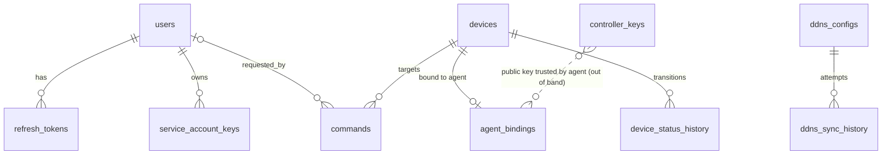

# HomeCore — Database Design

| | |
|---|---|
| Engine | SQLite 3 (embedded) via `modernc.org/sqlite` (pure Go, [ADR-004](decisions.md#adr-004--sqlite-driver-moderncorgsqlite-everywhere)) |
| Schema version | `10` (`internal/storage/migrations/0001_init.sql` … `0010_openapi_setting.sql`) |
| Owner role | Controller only. The Agent has no database |
| Requirements | [storage-and-secrets.md](../requirements/storage-and-secrets.md) |
| Last reviewed | 2026-11-26 (`devices.hostname` deprecated, no schema change); 2026-11-23 (OpenAPI setting: migration 0010); 2026-11-18 (port forwarding: migration 0009); 2026-11-15 (alerts: migration 0008; earlier: 2026-11-14 service account keys: migration 0007; Phase 4: migration 0006, DDNS observed state and record uniqueness; earlier: Phase 3 migration 0005) |

The DDL in `internal/storage/migrations/` is authoritative. This document explains it and must be
updated in the same change as any new migration.

---

## 1. Conventions

| Topic | Rule |
|-------|------|
| Table type | Every table is `STRICT` (column types are enforced) |
| Primary keys | Entities: `TEXT` UUIDv7 (time-sortable, generated in Go). Append-only logs: `INTEGER PRIMARY KEY` (rowid) |
| Timestamps | `INTEGER` unix **milliseconds**, UTC (`storage.Millis` / `storage.FromMillis`); API renders RFC 3339 |
| Booleans | `INTEGER` with `CHECK (x IN (0, 1))` |
| Enums | `TEXT` with a `CHECK (x IN (...))` matching the Go constants and the OpenAPI enum |
| Optional text | `NOT NULL DEFAULT ''` rather than `NULL`, so Go scans into `string` |
| Optional time | Nullable `INTEGER` |
| Secrets | `BLOB` sealed with AES-256-GCM (`internal/secrets`), column suffix `_sealed`, associated data `"<table>.<column>"` |
| Tokens | Only hashes are stored (`refresh_tokens.token_hash` = SHA-256) |
| Case-insensitive names | `COLLATE NOCASE` on `users.username` and `devices.name` |
| Deletion | Hard deletes; children follow via `ON DELETE CASCADE` (or `SET NULL` for actor references) |

## 2. Connection and operational settings

| Setting | Value | Why |
|---------|-------|-----|
| File | `<data_dir>/homecore.db`, mode `0600`, dir `0700` | Contains password hashes and sealed secrets |
| `journal_mode` | `WAL` | Readers never block the writer |
| `busy_timeout` | `5000` ms | Absorbs short write contention |
| `foreign_keys` | `ON` | Enforce relations and cascades |
| `synchronous` | `NORMAL` | Safe with WAL, far fewer fsyncs (good for SD/eMMC storage) |
| `_txlock` | `immediate` | Write transactions take the lock at `BEGIN`; no mid-transaction `SQLITE_BUSY` |
| Pool | 4 open / 4 idle, idle timeout 5 min | Low concurrency workload |
| Backup | `VACUUM INTO '<path>'` (`DB.Backup`) | Consistent online snapshot |

## 3. Entity-relationship overview

Standalone tables: `audit_log` (references users/targets by value, so entries outlive deletions),
`alert_channels`, `port_forward_rules`, `system_settings`, `schema_migrations`.

Mapping from the brief's table list (§3.7):

| Brief | Implemented as | Note |
|-------|----------------|------|
| `devices` | `devices` | `shutdown_port` → `agent_bindings.port`; `shutdown_secret` removed (ADR-001) |
| `device_status_history` | `device_status_history` | Transitions only |
| `users` | `users` | |
| `refresh_tokens` | `refresh_tokens` | Hashed, rotating, family-based reuse detection |
| — | `service_account_keys` | Added (ADR-018): long-lived scoped credentials for legacy clients and AI agents |
| `agent_credentials` | `agent_bindings` + `controller_keys` | Ed25519: the secret belongs to the Controller |
| `command_history` | `commands` | Lifecycle state machine, not just history |
| `ddns_configs` | `ddns_configs` | |
| `ddns_sync_history` | `ddns_sync_history` | |
| — | `alert_channels` | Added (ADR-021): destinations for alerts (Telegram, ...) with their sealed secret |
| — | `port_forward_rules` | Added (ADR-022): port forwarding rules with their stored on/off switch |
| `system_settings` | `system_settings` | |
| — | `audit_log` | Added: brief §6 requires an audit log for shutdown |
| — | `schema_migrations` | Added: migration bookkeeping |

## 4. Tables

### users

Accounts for the REST API. No roles (ADR-011): migration `0003` dropped the `role` column.

| Column | Type | Null | Default | Constraint / note |
|--------|------|------|---------|-------------------|
| `id` | TEXT | no | | PK, UUIDv7 |
| `username` | TEXT | no | | `UNIQUE COLLATE NOCASE` |
| `password_hash` | TEXT | no | | argon2id PHC string `$argon2id$v=19$m=…,t=…,p=…$salt$key`; parameters travel with the hash, so they can be raised and old hashes are upgraded at the next login |
| `disabled` | INTEGER | no | `0` | bool |
| `created_at`, `updated_at` | INTEGER | no | | unix ms |

### refresh_tokens

Rotating refresh tokens. Using a token marks it `used_at` and issues a new one in the same
`family_id`. Presenting an already-used token revokes the whole family (theft detection), except
within the 10 s grace window, where the already issued successor pair is returned (see
`successor_sealed`). Flow and states: [architecture §10.1](architecture.md#101-authentication-design).

| Column | Type | Null | Constraint / note |
|--------|------|------|-------------------|
| `id` | TEXT | no | PK |
| `user_id` | TEXT | no | FK → `users(id)` `ON DELETE CASCADE` |
| `family_id` | TEXT | no | groups a rotation chain |
| `token_hash` | BLOB | no | `UNIQUE`; SHA-256 of the opaque token |
| `expires_at` | INTEGER | no | |
| `used_at`, `revoked_at` | INTEGER | yes | |
| `created_at` | INTEGER | no | |
| `successor_sealed` | BLOB | yes | migration `0004`. JSON `{access token, refresh token, access expiry}` of the pair issued when this row was rotated, sealed with AES-GCM, AAD `refresh_tokens.successor`. Set at rotation, set to `NULL` at the next rotation of the family, when the family is revoked, and by the maintenance job once `used_at` is older than 10 s. Non-`NULL` only on a used row inside the grace window; never holds anything for longer |

Indexes: `refresh_tokens_user (user_id)`, `refresh_tokens_family (family_id)`.

Revoking a family sets `revoked_at` on every row of it. Rows are deleted by `auth.Service.Maintain`: expired or revoked more than 24 h ago, or rotated (used) more than 7 days ago.

### service_account_keys

Service account keys (ADR-018, migration `0007`), written by `internal/servicekey`. One row per key; the
credential handed to the client is a JWT signed with the row's private key, derivable from the row and
never stored. The private key is a sealed BLOB (REQ-SEC-006).

| Column | Type | Null | Constraint / note |
|--------|------|------|-------------------|
| `id` | TEXT | no | PK, UUIDv7; also the credential's `kid` and `jti` |
| `user_id` | TEXT | no | FK `users(id)` `ON DELETE CASCADE`: deleting the owner deletes the keys |
| `name` | TEXT | no | 1..64 characters |
| `scope` | TEXT | no | `legacy` \| `mcp`; matched against `x-token-scopes` |
| `public_key` | BLOB | no | 32 bytes Ed25519; verifies the credential |
| `private_key_sealed` | BLOB | no | the 32-byte seed, AES-GCM with the master key, AAD `service_account_keys.private_key:<id>` |
| `ttl_seconds` | INTEGER | no | `> 0`; lifetime chosen at creation, reused by a rotation |
| `created_at` | INTEGER | no | |
| `expires_at` | INTEGER | no | immutable end of life |
| `revoked_at` | INTEGER | yes | set by `DELETE /service-account-keys/{id}` |
| `superseded_at` | INTEGER | yes | set when a rotation replaced the key; it works for 1 more minute (`servicekey.RotationGrace`) |
| `rotated_to` | TEXT | yes | id of the successor; no FK, because pruning may delete either row |
| `last_used_at` | INTEGER | yes | refreshed at most once a minute |

A key authenticates while `revoked_at IS NULL`, `now < expires_at` and (`superseded_at IS NULL` or
`now < superseded_at + 1 min`). Index: `service_account_keys_user (user_id, created_at)`.

### devices

The device registry. Identity is `id`; addresses are mutable attributes (ADR-002).

| Column | Type | Null | Default | Constraint / note |
|--------|------|------|---------|-------------------|
| `id` | TEXT | no | | PK, UUIDv7 |
| `name` | TEXT | no | | `UNIQUE COLLATE NOCASE` (API → `409` on clash) |
| `description` | TEXT | no | `''` | |
| `hostname` | TEXT | no | `''` | **Deprecated**, ignored since 2026-11-26 (never a probe target). Kept for compatibility; remove with a migration later |
| `ip_address` | TEXT | no | | probe target (always), agent address; WOL subnet detection |
| `mac_address` | TEXT | no | `''` | normalised `aa:bb:cc:dd:ee:ff`; empty = WOL unavailable |
| `wol_broadcast_address` | TEXT | no | `''` | override; empty = auto (directed broadcast) |
| `wol_port` | INTEGER | no | `9` | 1–65535 |
| `monitor_port` | INTEGER | no | | 1–65535 (e.g. 22, 3389, 9750) |
| `monitor_interval_seconds` | INTEGER | no | `30` | 5–3600 |
| `monitor_timeout_ms` | INTEGER | no | `2000` | 100–10000 |
| `enabled` | INTEGER | no | `1` | bool; disabled devices are not probed |
| `device_type` | TEXT | no | `'desktop'` | `desktop` \| `server` \| `laptop` \| `tv` \| `nas` \| `iot` \| `router`; informational (0002) |
| `os` | TEXT | no | `'linux'` | `windows` \| `linux` \| `macos` \| `android` \| `freebsd` \| `embedded`; informational (0002) |
| `status` | TEXT | no | `'unknown'` | `unknown` \| `online` \| `offline` (observed only; written by `RecordObservation`, never by the device API) |
| `last_seen_at` | INTEGER | yes | | last successful probe |
| `last_checked_at` | INTEGER | yes | | last probe of any result |
| `last_latency_ms` | INTEGER | yes | | connect time of the last successful probe (0002); written by the monitor, kept across failures |
| `created_at`, `updated_at` | INTEGER | no | | |

`power_transition` (`none`/`waking`/`shutting_down`) is **not stored**. It is derived from the
active row in `commands`.

### agent_bindings

Optional 1:1 link from a device to the HomeCore Agent running on it. Holds no secret. Migration `0005` added the three status columns, which record what the Controller last learned from the Agent (see [ADR-015](decisions.md)).

| Column | Type | Null | Default | Constraint / note |
|--------|------|------|---------|-------------------|
| `device_id` | TEXT | no | | PK, FK → `devices(id)` `ON DELETE CASCADE` |
| `agent_id` | TEXT | no | | `UNIQUE` (binding the same agent to a second device → `409`); the Agent's self-generated UUID |
| `port` | INTEGER | no | `9750` | 1–65535 |
| `scheme` | TEXT | no | `'http'` | `http` \| `https` |
| `agent_public_key` | BLOB | yes | | reserved for signed acknowledgements (protocol v2) |
| `status` | TEXT | no | `'unknown'` | `ready` \| `unreachable` \| `unknown` (CHECK). Written by the shutdown Dispatcher and the health job through `RecordAgentContact`; reset to `unknown` (with `version`, `last_ok_at`) only when `agent_id`, `port` or `scheme` changes |
| `version` | TEXT | no | `''` | Agent version from its last healthz answer |
| `last_ok_at` | INTEGER | yes | | unix ms of the last answer from the bound agent |
| `created_at`, `updated_at` | INTEGER | no | | |

### controller_keys

The Controller's Ed25519 signing keys. Written since Phase 3 by `internal/controllerkey` (`LoadOrCreate` inside one transaction on first start or `homecore key show`; the seed is sealed, a unique violation from a concurrent first start is retried and reads the winner). Rotation (not implemented yet): insert a new key and set `retired_at` on the old one.

| Column | Type | Null | Constraint / note |
|--------|------|------|-------------------|
| `key_id` | TEXT | no | PK; hex(SHA-256(public_key)[:8]) |
| `public_key` | BLOB | no | 32 bytes |
| `private_key_sealed` | BLOB | no | sealed, AAD `controller_keys.private_key` |
| `created_at` | INTEGER | no | |
| `retired_at` | INTEGER | yes | `NULL` = active |

Index: `controller_keys_one_active` — unique on a constant expression `WHERE retired_at IS NULL`, so
at most one active key can exist.

### device_status_history

Status **transitions** only (not every probe), to keep the DB small.

| Column | Type | Null | Constraint / note |
|--------|------|------|-------------------|
| `id` | INTEGER | no | PK (rowid) |
| `device_id` | TEXT | no | FK → `devices(id)` `ON DELETE CASCADE` |
| `status` | TEXT | no | new status enum |
| `previous_status` | TEXT | yes | previous status enum |
| `reason` | TEXT | no | `probe` (scheduled tick) or `manual probe` (`POST .../probe`); default `''` |
| `changed_at` | INTEGER | no | |

Index: `device_status_history_device (device_id, changed_at DESC)`. Listing is newest first, keyset-paged on `(changed_at, id)`.

### commands

Asynchronous wake/shutdown commands. Lifecycle: [architecture §8.2](architecture.md#82-command-lifecycle).

| Column | Type | Null | Default | Constraint / note |
|--------|------|------|---------|-------------------|
| `id` | TEXT | no | | PK, UUIDv7; also the protocol `command_id` |
| `device_id` | TEXT | no | | FK → `devices(id)` `ON DELETE CASCADE` |
| `type` | TEXT | no | | `wake` \| `shutdown` |
| `status` | TEXT | no | | `pending` \| `sent` \| `acknowledged` \| `completed` \| `failed` \| `timed_out` |
| `requested_by` | TEXT | yes | | FK → `users(id)` `ON DELETE SET NULL` |
| `error_code` | TEXT | no | `''` | e.g. agent `clock_skew` |
| `error` | TEXT | no | `''` | human-readable |
| `attempts` | INTEGER | no | `0` | dispatch attempts |
| `deadline_at` | INTEGER | yes | | verification deadline |
| `sent_at`, `acknowledged_at`, `completed_at` | INTEGER | yes | | |
| `created_at`, `updated_at` | INTEGER | no | | |

Indexes:
- `commands_device (device_id, created_at DESC)`: per-device history.
- `commands_created (created_at DESC)`: global history listing.
- `commands_one_active`: **unique** on `(device_id, type) WHERE status IN ('pending','sent','acknowledged')`.
  The database itself guarantees at most one in-flight command per device and type (ADR-003). The
  engine maps the constraint violation to "return the active command" (`commands.ErrActiveExists`), so concurrent requests converge on one row. Listing is newest first, keyset-paged on `(created_at, id)`; `commands_created` serves the unfiltered list and `commands_device` the `device_id` filter.

### audit_log

Append-only record of security-relevant actions (login, shutdown, key rotation, config changes). Written by `internal/audit`. Actions today: `auth.login` (`result` `ok`/`failed`; failure reason in `details`), `auth.logout`, `auth.refresh_reuse` (`revoked`), `user.create`, `user.password_change` (`actor` `cli`), and the device actions `device.create`, `device.update` (`details.fields` lists the changed fields), `device.delete`, `device.agent_remove` (`target_type` `device`, `target_id` the device id; `details.name` for create/update/delete) and `device.wake` (`details.command_id`, `status`). Since Phase 3 also `device.shutdown` (`result` `ok` when the command was accepted or already complete, `failed` with `details.error_code` when dispatch failed; `details.command_id`, `status`, `name`) and `controller_key.create` (`actor` `system` on server start or `cli` for `homecore key show`; `target_type` `controller_key`, `target_id` the key id, `details.key_id`). Only successful requests are written for the device actions above; rejected ones (400/404/409/429) are not. `GET /activity` reads this table (ADR-015): the category is derived from the action prefix, and only a whitelist of `details` keys is exposed. A failed login stores `actor`/`actor_user_id` only when the submitted username is an existing account.

| Column | Type | Null | Default | Note |
|--------|------|------|---------|------|
| `id` | INTEGER | no | | PK (rowid) |
| `at` | INTEGER | no | | |
| `actor_user_id` | TEXT | yes | | no FK, so entries survive user deletion |
| `actor` | TEXT | no | `''` | username snapshot |
| `action` | TEXT | no | | e.g. `device.shutdown` |
| `target_type`, `target_id` | TEXT | no | `''` | |
| `result` | TEXT | no | `''` | `ok` / error code |
| `remote_addr` | TEXT | no | `''` | client IP |
| `details` | TEXT | no | `'{}'` | JSON, never secrets |

Index: `audit_log_at (at DESC)`.

### alert_channels

One alert destination per row (migration `0008`, [ADR-021](decisions.md#adr-021--alerts-channels-adapters-and-hooks-in-the-producers), [alerts.md](../requirements/alerts.md)).

| Column | Type | Null | Default | Constraint / note |
|--------|------|------|---------|-------------------|
| `id` | TEXT | no | | PK, UUIDv7 |
| `name` | TEXT | no | | length 1..100; unique ignoring case (index `alert_channels_name`) |
| `type` | TEXT | no | | adapter name (`telegram`). **No `CHECK`**: the service validates it against the registered adapters, so a new adapter needs no migration |
| `enabled` | INTEGER | no | `1` | bool |
| `events` | TEXT | no | | JSON array of `ip_changed`, `power_command`, `status_changed` (canonical order), read as a whole |
| `settings` | TEXT | no | `'{}'` | JSON object of non-secret string settings (telegram: `target_user_id`) |
| `secret_sealed` | BLOB | no | | the adapter's one secret (telegram: the bot token), sealed, AAD `alert_channels.secret`; never returned |
| `last_sent_at` | INTEGER | yes | | last successful delivery, tests included |
| `last_error` | TEXT | no | `''` | reason of the last failed delivery (cut to 500 characters, never the secret); `''` after a success |
| `last_error_at` | INTEGER | yes | | |
| `created_at`, `updated_at` | INTEGER | no | | `updated_at` changes with edits only, never with a delivery |

Writers: `alerts.Service` (create/update/delete, sealed secret) and the delivery path (`RecordDelivery`, which
touches only the three `last_*` columns). Pruning: none (a few rows, edited by the owner).

### port_forward_rules

One port forwarding rule per row (migration `0009`, [ADR-022](decisions.md#adr-022--port-forwarding-a-userspace-relay-driven-by-stored-rules), [port-forwarding.md](../requirements/port-forwarding.md)).

| Column | Type | Null | Default | Constraint / note |
|--------|------|------|---------|-------------------|
| `id` | TEXT | no | | PK, UUIDv7 |
| `name` | TEXT | no | | length 1..100; unique ignoring case (index `port_forward_rules_name`) |
| `protocol` | TEXT | no | | `CHECK` in (`tcp`, `udp`, `universal`); `universal` = TCP and UDP on the same port |
| `listen_address` | TEXT | no | `'0.0.0.0'` | canonical IP literal of a local interface; `0.0.0.0` = all IPv4, `::` = all. Syntax only: whether the host has it is decided at bind time |
| `listen_port` | INTEGER | no | | 1..65535 |
| `target_host` | TEXT | no | | IP literal or lower-case host name, length 1..253; resolved on every new connection |
| `target_port` | INTEGER | no | | 1..65535 |
| `enabled` | INTEGER | no | `1` | bool: the **desired** state, the on/off switch. The Controller starts every enabled rule at boot and retries the ones that cannot bind. Whether a listener is open now (`running`/`error`) is **not stored** |
| `created_at`, `updated_at` | INTEGER | no | | unix ms |

Overlap between enabled rules (same port, shared protocol, equal or wildcard address) is checked by the service, not by an index:
a disabled rule must not reserve the socket. Writers: `portforward.Service` only. Pruning: none (a few rows, edited by the owner).

### ddns_configs

One managed Cloudflare DNS record per row.

| Column | Type | Null | Default | Constraint / note |
|--------|------|------|---------|-------------------|
| `id` | TEXT | no | | PK |
| `name` | TEXT | no | | display name |
| `zone_id` | TEXT | no | | Cloudflare zone |
| `record_name` | TEXT | no | | FQDN |
| `record_type` | TEXT | no | | `A` \| `AAAA` |
| `proxied` | INTEGER | no | `0` | bool |
| `ttl` | INTEGER | no | `1` | 1 = automatic |
| `interval_seconds` | INTEGER | no | `300` | |
| `enabled` | INTEGER | no | `1` | bool |
| `api_token_sealed` | BLOB | no | | sealed, AAD `ddns_configs.api_token`; never returned |
| `cf_record_id` | TEXT | no | `''` | Cloudflare record id, always the one chosen in the form's record dropdown (`record_id` is required by the API; `''` only for rows that predate it) |
| `last_ip` | TEXT | no | `''` | last value written/confirmed at Cloudflare |
| `last_synced_at` | INTEGER | yes | | last success |
| `last_error` | TEXT | no | `''` | text of the last failed attempt; contains no token or provider URL |
| `last_error_at` | INTEGER | yes | | |
| `detected_ip` | TEXT | no | `''` | migration `0006`: public address of the last successful discovery |
| `dns_value` | TEXT | no | `''` | migration `0006`: content of the Cloudflare record as last read |
| `last_checked_at` | INTEGER | yes | | migration `0006`: last attempt that reached a verdict, changed or not |
| `created_at`, `updated_at` | INTEGER | no | | |

Constraints: `UNIQUE (zone_id, record_name, record_type)`; since `0006` also the partial unique index `ddns_configs_record (zone_id, cf_record_id) WHERE cf_record_id <> ''`, so two configurations can never fight over one Cloudflare record (the repository maps both violations to `ddns.ErrDuplicate`, HTTP `400`).

Writers: `ddns.Service` (create/update/delete, sealed token) and the sync path (`SaveOutcome`, a conditional update on `updated_at` so a sync that raced with an edit is dropped and writes no history). A change of `zone_id`, `cf_record_id`, `record_name` or `record_type` clears `last_ip`, `detected_ip`, `dns_value`, `last_synced_at`, `last_checked_at` and the error fields. [ADR-016](decisions.md#adr-016--phase-4-decisions-public-ip-quorum-record-ids-ddns-state-and-metrics).

### ddns_sync_history

One row per sync attempt that reached a verdict (`updated`, `unchanged`, `failed`), written in the same transaction as the configuration's state.

| Column | Type | Null | Constraint / note |
|--------|------|------|-------------------|
| `id` | INTEGER | no | PK (rowid) |
| `config_id` | TEXT | no | FK → `ddns_configs(id)` `ON DELETE CASCADE` |
| `result` | TEXT | no | `updated` \| `unchanged` \| `failed` |
| `ip` | TEXT | no | default `''` |
| `error` | TEXT | no | default `''` |
| `at` | INTEGER | no | |

Index: `ddns_sync_history_config (config_id, at DESC)`.

### system_settings

The `openapi_enabled` key stores a single byte (`0` or `1`) and defaults to `0` in migration 0010.
The Controller fails closed when the row is absent or cannot be read.

Key/value store for Controller-wide settings.

| Column | Type | Null | Note |
|--------|------|------|------|
| `key` | TEXT | no | PK. Used today: `auth.jwt_signing_key` (32-byte HS256 key, sealed, created at first start) |
| `value` | BLOB | no | secret values sealed with AAD `system_settings.<key>` |
| `updated_at` | INTEGER | no | |

### schema_migrations

Created by the migration runner (not by a migration file).

| Column | Type | Note |
|--------|------|------|
| `version` | INTEGER PK | from the file prefix `NNNN` |
| `name` | TEXT | from the file name |
| `applied_at` | INTEGER | unix ms |

## 5. Data lifecycle

| Data | Growth | Retention |
|------|--------|-----------|
| `device_status_history` | per transition | pruned after `controller.retention_days` (default 30) by `internal/retention` |
| `commands` (terminal) | per wake/shutdown | terminal rows (`completed`, `failed`, `timed_out`) pruned after `retention_days`, by `updated_at`; active commands are never pruned |
| `ddns_sync_history` | per sync attempt | pruned after `retention_days` (`ddns.PruneSyncHistory`) |
| `refresh_tokens` | per login/refresh | implemented by `auth.Service.Maintain` (every minute): expired or revoked > 24 h, rotated > 7 days; sealed successor copies wiped after 10 s |
| `service_account_keys` | per key and per rotation | rows that expired, were revoked or were superseded more than `retention_days` ago are pruned by `internal/retention` (`servicekey.Service.Prune`) |
| `audit_log` | per privileged action | kept (small); export/prune is a future admin feature |

**Retention job** (`internal/retention`, implemented in Phase 2): `Run(ctx)` runs once at start and
then every hour; each target deletes at most 500 rows per statement and repeats until a batch comes
back short, so a long backlog never holds the single SQLite writer for long. `retention_days: 0`
disables pruning (keep everything). A failing target is logged and does not stop the others. The
cutoff is `now - retention_days` with an injectable clock (tests use a fake).

**Foreign-key cascades.** `DELETE /devices/{id}` removes, in the same statement and transaction,
the device's `agent_bindings`, `device_status_history` and `commands` rows (`ON DELETE CASCADE`),
including active commands: deleting a device cancels whatever was in flight for it (a wake in
progress simply stops being tracked; nothing is sent to the machine). `commands.requested_by` is
`ON DELETE SET NULL`. `audit_log` has no foreign keys, so the delete is recorded and the earlier
entries remain. `PRAGMA foreign_keys` is on for every connection (section 2).

**Cursors.** List endpoints use keyset pagination over indexed columns, no `OFFSET` (architecture
§9): devices `(name COLLATE NOCASE, id)`, commands `(created_at, id)` and history `(changed_at, id)`
descending. Cursors are not stored.

## 6. Migration process

1. Add `internal/storage/migrations/NNNN_short_description.sql` with the next version number.
2. Never edit the SQL of a migration that has been released; fix forward with a new migration.
3. Write it to run inside one transaction (the runner wraps it). SQLite cannot `ALTER` constraints:
   to change a table, create `x_new`, copy, drop, rename, then recreate indexes.
4. Update this document (affected tables, indexes, the mapping table) and the changelog.
5. `go test ./internal/storage/` checks that migrations apply to a fresh DB and are idempotent.

`/readyz` reports `not_ready` while the DB schema is behind the newest embedded migration.
