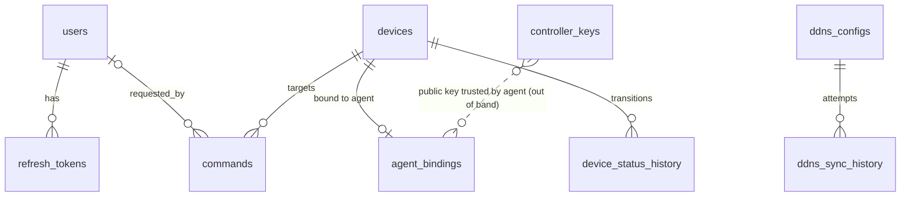

# HomeCore — Database Design

| | |
|---|---|
| Engine | SQLite 3 (embedded) via `modernc.org/sqlite` (pure Go, [ADR-004](decisions.md#adr-004--sqlite-driver-moderncorgsqlite-everywhere)) |
| Schema version | `1` (`internal/storage/migrations/0001_init.sql`) |
| Owner role | Controller only. The Agent has no database |
| Requirements | [storage-and-secrets.md](../requirements/storage-and-secrets.md) |
| Last reviewed | 2026-11-11 |

The DDL in `internal/storage/migrations/` is authoritative. This document explains it and must be
updated in the same change as any new migration.

---

## 1. Conventions

| Topic | Rule |
|-------|------|
| Table type | Every table is `STRICT` (column types are enforced) |
| Primary keys | Entities: `TEXT` UUIDv7 (time-sortable, generated in Go). Append-only logs: `INTEGER PRIMARY KEY` (rowid) |
| Timestamps | `INTEGER` unix **milliseconds**, UTC (`storage.Millis` / `storage.FromMillis`); API renders RFC 3339 |
| Booleans | `INTEGER` with `CHECK (x IN (0, 1))` |
| Enums | `TEXT` with a `CHECK (x IN (...))` matching the Go constants and the OpenAPI enum |
| Optional text | `NOT NULL DEFAULT ''` rather than `NULL`, so Go scans into `string` |
| Optional time | Nullable `INTEGER` |
| Secrets | `BLOB` sealed with AES-256-GCM (`internal/secrets`), column suffix `_sealed`, associated data `"<table>.<column>"` |
| Tokens | Only hashes are stored (`refresh_tokens.token_hash` = SHA-256) |
| Case-insensitive names | `COLLATE NOCASE` on `users.username` and `devices.name` |
| Deletion | Hard deletes; children follow via `ON DELETE CASCADE` (or `SET NULL` for actor references) |

## 2. Connection and operational settings

| Setting | Value | Why |
|---------|-------|-----|
| File | `<data_dir>/homecore.db`, mode `0600`, dir `0700` | Contains password hashes and sealed secrets |
| `journal_mode` | `WAL` | Readers never block the writer |
| `busy_timeout` | `5000` ms | Absorbs short write contention |
| `foreign_keys` | `ON` | Enforce relations and cascades |
| `synchronous` | `NORMAL` | Safe with WAL, far fewer fsyncs (good for SD/eMMC storage) |
| `_txlock` | `immediate` | Write transactions take the lock at `BEGIN`; no mid-transaction `SQLITE_BUSY` |
| Pool | 4 open / 4 idle, idle timeout 5 min | Low concurrency workload |
| Backup | `VACUUM INTO '<path>'` (`DB.Backup`) | Consistent online snapshot |

## 3. Entity-relationship overview

Standalone tables: `audit_log` (references users/targets by value, so entries outlive deletions),
`system_settings`, `schema_migrations`.

Mapping from the brief's table list (§3.7):

| Brief | Implemented as | Note |
|-------|----------------|------|
| `devices` | `devices` | `shutdown_port` → `agent_bindings.port`; `shutdown_secret` removed (ADR-001) |
| `device_status_history` | `device_status_history` | Transitions only |
| `users` | `users` | |
| `refresh_tokens` | `refresh_tokens` | Hashed, rotating, family-based reuse detection |
| `agent_credentials` | `agent_bindings` + `controller_keys` | Ed25519: the secret belongs to the Controller |
| `command_history` | `commands` | Lifecycle state machine, not just history |
| `ddns_configs` | `ddns_configs` | |
| `ddns_sync_history` | `ddns_sync_history` | |
| `system_settings` | `system_settings` | |
| — | `audit_log` | Added: brief §6 requires an audit log for shutdown |
| — | `schema_migrations` | Added: migration bookkeeping |

## 4. Tables

### users

Accounts for the REST API.

| Column | Type | Null | Default | Constraint / note |
|--------|------|------|---------|-------------------|
| `id` | TEXT | no | | PK, UUIDv7 |
| `username` | TEXT | no | | `UNIQUE COLLATE NOCASE` |
| `password_hash` | TEXT | no | | argon2id encoded string (planned) |
| `role` | TEXT | no | | `admin` \| `viewer` |
| `disabled` | INTEGER | no | `0` | bool |
| `created_at`, `updated_at` | INTEGER | no | | unix ms |

### refresh_tokens

Rotating refresh tokens. Using a token marks it `used_at` and issues a new one in the same
`family_id`. Presenting an already-used token revokes the whole family (theft detection).

| Column | Type | Null | Constraint / note |
|--------|------|------|-------------------|
| `id` | TEXT | no | PK |
| `user_id` | TEXT | no | FK → `users(id)` `ON DELETE CASCADE` |
| `family_id` | TEXT | no | groups a rotation chain |
| `token_hash` | BLOB | no | `UNIQUE`; SHA-256 of the opaque token |
| `expires_at` | INTEGER | no | |
| `used_at`, `revoked_at` | INTEGER | yes | |
| `created_at` | INTEGER | no | |

Indexes: `refresh_tokens_user (user_id)`, `refresh_tokens_family (family_id)`.

### devices

The device registry. Identity is `id`; addresses are mutable attributes (ADR-002).

| Column | Type | Null | Default | Constraint / note |
|--------|------|------|---------|-------------------|
| `id` | TEXT | no | | PK, UUIDv7 |
| `name` | TEXT | no | | `UNIQUE COLLATE NOCASE` (API → `409` on clash) |
| `description` | TEXT | no | `''` | |
| `hostname` | TEXT | no | `''` | probe target if set |
| `ip_address` | TEXT | no | | probe target otherwise; WOL subnet detection |
| `mac_address` | TEXT | no | `''` | normalised `aa:bb:cc:dd:ee:ff`; empty = WOL unavailable |
| `wol_broadcast_address` | TEXT | no | `''` | override; empty = auto (directed broadcast) |
| `wol_port` | INTEGER | no | `9` | 1–65535 |
| `monitor_port` | INTEGER | no | | 1–65535 (e.g. 22, 3389, 9750) |
| `monitor_interval_seconds` | INTEGER | no | `30` | 5–3600 |
| `monitor_timeout_ms` | INTEGER | no | `2000` | 100–10000 |
| `enabled` | INTEGER | no | `1` | bool; disabled devices are not probed |
| `status` | TEXT | no | `'unknown'` | `unknown` \| `online` \| `offline` (observed only) |
| `last_seen_at` | INTEGER | yes | | last successful probe |
| `last_checked_at` | INTEGER | yes | | last probe of any result |
| `created_at`, `updated_at` | INTEGER | no | | |

`power_transition` (`none`/`waking`/`shutting_down`) is **not stored**. It is derived from the
active row in `commands`.

### agent_bindings

Optional 1:1 link from a device to the HomeCore Agent running on it. Holds no secret.

| Column | Type | Null | Default | Constraint / note |
|--------|------|------|---------|-------------------|
| `device_id` | TEXT | no | | PK, FK → `devices(id)` `ON DELETE CASCADE` |
| `agent_id` | TEXT | no | | `UNIQUE`; the Agent's self-generated UUID |
| `port` | INTEGER | no | `9750` | 1–65535 |
| `scheme` | TEXT | no | `'http'` | `http` \| `https` |
| `agent_public_key` | BLOB | yes | | reserved for signed acknowledgements (protocol v2) |
| `created_at`, `updated_at` | INTEGER | no | | |

### controller_keys

The Controller's Ed25519 signing keys. Rotation: insert a new key and set `retired_at` on the old one.

| Column | Type | Null | Constraint / note |
|--------|------|------|-------------------|
| `key_id` | TEXT | no | PK; hex(SHA-256(public_key)[:8]) |
| `public_key` | BLOB | no | 32 bytes |
| `private_key_sealed` | BLOB | no | sealed, AAD `controller_keys.private_key` |
| `created_at` | INTEGER | no | |
| `retired_at` | INTEGER | yes | `NULL` = active |

Index: `controller_keys_one_active` — unique on a constant expression `WHERE retired_at IS NULL`, so
at most one active key can exist.

### device_status_history

Status **transitions** only (not every probe), to keep the DB small.

| Column | Type | Null | Constraint / note |
|--------|------|------|-------------------|
| `id` | INTEGER | no | PK (rowid) |
| `device_id` | TEXT | no | FK → `devices(id)` `ON DELETE CASCADE` |
| `status` | TEXT | no | new status enum |
| `previous_status` | TEXT | yes | previous status enum |
| `reason` | TEXT | no | e.g. `probe`, `wake command completed`; default `''` |
| `changed_at` | INTEGER | no | |

Index: `device_status_history_device (device_id, changed_at DESC)`.

### commands

Asynchronous wake/shutdown commands. Lifecycle: [architecture §8.2](architecture.md#82-command-lifecycle).

| Column | Type | Null | Default | Constraint / note |
|--------|------|------|---------|-------------------|
| `id` | TEXT | no | | PK, UUIDv7; also the protocol `command_id` |
| `device_id` | TEXT | no | | FK → `devices(id)` `ON DELETE CASCADE` |
| `type` | TEXT | no | | `wake` \| `shutdown` |
| `status` | TEXT | no | | `pending` \| `sent` \| `acknowledged` \| `completed` \| `failed` \| `timed_out` |
| `requested_by` | TEXT | yes | | FK → `users(id)` `ON DELETE SET NULL` |
| `error_code` | TEXT | no | `''` | e.g. agent `clock_skew` |
| `error` | TEXT | no | `''` | human-readable |
| `attempts` | INTEGER | no | `0` | dispatch attempts |
| `deadline_at` | INTEGER | yes | | verification deadline |
| `sent_at`, `acknowledged_at`, `completed_at` | INTEGER | yes | | |
| `created_at`, `updated_at` | INTEGER | no | | |

Indexes:
- `commands_device (device_id, created_at DESC)`: per-device history.
- `commands_created (created_at DESC)`: global history listing.
- `commands_one_active`: **unique** on `(device_id, type) WHERE status IN ('pending','sent','acknowledged')`.
  The database itself guarantees at most one in-flight command per device and type (ADR-003). The
  service maps the constraint violation to "return the active command".

### audit_log

Append-only record of security-relevant actions (login, shutdown, key rotation, config changes).

| Column | Type | Null | Default | Note |
|--------|------|------|---------|------|
| `id` | INTEGER | no | | PK (rowid) |
| `at` | INTEGER | no | | |
| `actor_user_id` | TEXT | yes | | no FK, so entries survive user deletion |
| `actor` | TEXT | no | `''` | username snapshot |
| `action` | TEXT | no | | e.g. `device.shutdown` |
| `target_type`, `target_id` | TEXT | no | `''` | |
| `result` | TEXT | no | `''` | `ok` / error code |
| `remote_addr` | TEXT | no | `''` | client IP |
| `details` | TEXT | no | `'{}'` | JSON, never secrets |

Index: `audit_log_at (at DESC)`.

### ddns_configs

One managed Cloudflare DNS record per row.

| Column | Type | Null | Default | Constraint / note |
|--------|------|------|---------|-------------------|
| `id` | TEXT | no | | PK |
| `name` | TEXT | no | | display name |
| `zone_id` | TEXT | no | | Cloudflare zone |
| `record_name` | TEXT | no | | FQDN |
| `record_type` | TEXT | no | | `A` \| `AAAA` |
| `proxied` | INTEGER | no | `0` | bool |
| `ttl` | INTEGER | no | `1` | 1 = automatic |
| `interval_seconds` | INTEGER | no | `300` | |
| `enabled` | INTEGER | no | `1` | bool |
| `api_token_sealed` | BLOB | no | | sealed, AAD `ddns_configs.api_token`; never returned |
| `cf_record_id` | TEXT | no | `''` | cached Cloudflare record id |
| `last_ip` | TEXT | no | `''` | last value written/confirmed |
| `last_synced_at` | INTEGER | yes | | last success |
| `last_error` | TEXT | no | `''` | |
| `last_error_at` | INTEGER | yes | | |
| `created_at`, `updated_at` | INTEGER | no | | |

Constraint: `UNIQUE (zone_id, record_name, record_type)`.

### ddns_sync_history

| Column | Type | Null | Constraint / note |
|--------|------|------|-------------------|
| `id` | INTEGER | no | PK (rowid) |
| `config_id` | TEXT | no | FK → `ddns_configs(id)` `ON DELETE CASCADE` |
| `result` | TEXT | no | `updated` \| `unchanged` \| `failed` |
| `ip` | TEXT | no | default `''` |
| `error` | TEXT | no | default `''` |
| `at` | INTEGER | no | |

Index: `ddns_sync_history_config (config_id, at DESC)`.

### system_settings

Key/value store for Controller-wide settings.

| Column | Type | Null | Note |
|--------|------|------|------|
| `key` | TEXT | no | PK, e.g. `auth.jwt_signing_key` |
| `value` | BLOB | no | secret values sealed with AAD `system_settings.<key>` |
| `updated_at` | INTEGER | no | |

### schema_migrations

Created by the migration runner (not by a migration file).

| Column | Type | Note |
|--------|------|------|
| `version` | INTEGER PK | from the file prefix `NNNN` |
| `name` | TEXT | from the file name |
| `applied_at` | INTEGER | unix ms |

## 5. Data lifecycle

| Data | Growth | Retention (planned) |
|------|--------|---------------------|
| `device_status_history` | per transition | pruned after `controller.retention_days` (default 30) |
| `commands` (terminal) | per wake/shutdown | pruned after `retention_days` |
| `ddns_sync_history` | per sync attempt | pruned after `retention_days` |
| `refresh_tokens` | per login/refresh | delete expired or revoked rows |
| `audit_log` | per privileged action | kept (small); export/prune is a future admin feature |

The retention job is part of Phase 2 (see the [roadmap](../plans/roadmap.md)).

## 6. Migration process

1. Add `internal/storage/migrations/NNNN_short_description.sql` with the next version number.
2. Never edit the SQL of a migration that has been released; fix forward with a new migration.
3. Write it to run inside one transaction (the runner wraps it). SQLite cannot `ALTER` constraints:
   to change a table, create `x_new`, copy, drop, rename, then recreate indexes.
4. Update this document (affected tables, indexes, the mapping table) and the changelog.
5. `go test ./internal/storage/` checks that migrations apply to a fresh DB and are idempotent.

`/readyz` reports `not_ready` while the DB schema is behind the newest embedded migration.
